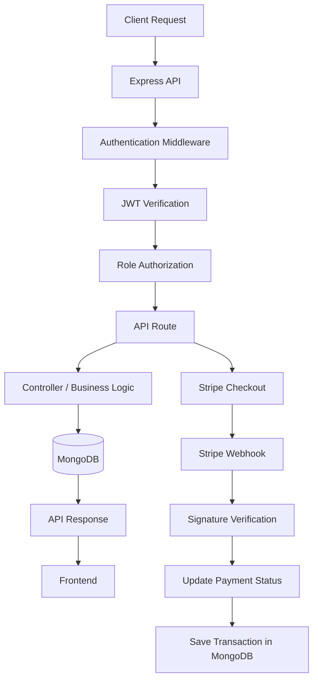

# SalonBook – Backend API

SalonBook Backend is a RESTful API server that powers the SalonBook salon appointment booking platform. It handles authentication, role-based authorization, service management, appointment processing, and secure payment transactions.

## 👥 System Actors

### 1. Customer
- Access and manage personal account information.
- Retrieve available salon services.
- Create appointment requests.
- View personal appointment history.
- Pay for confirmed appointments.
- Access payment and transaction history.

### 2. Administrator
- Manage salon services (Create, Read, Update, Delete).
- Retrieve and manage appointment requests.
- Confirm or manage customer appointments.
- Access transaction records.
- Manage administrative operations.

## 🔄 Backend Workflow

## ✨ Core Features

- **Authentication:** Secure authentication and user verification.
- **JWT Authorization:** Token-based authentication using JOSE.
- **Role-Based Access Control:** Separate permissions for customers and administrators.
- **User Management:** Handle user information and profile operations.
- **Service Management:** Create, retrieve, update, and delete salon services.
- **Appointment Management:** Process appointment requests and manage booking statuses.
- **Appointment Validation:** Validate booking ownership and prevent unauthorized operations.
- **Stripe Integration:** Create secure Stripe Checkout sessions.
- **Webhook Verification:** Verify Stripe webhook signatures before processing payment events.
- **Transaction Management:** Store verified payment records in MongoDB.
- **Protected API Routes:** Secure sensitive endpoints using authentication and authorization middleware.
- **Image Integration:** Support image hosting through ImgBB.

## 🛠️ Technologies Used

| Category | Technologies |
|---|---|
| Runtime | Node.js |
| Framework | Express.js |
| Database | MongoDB |
| Authentication | JWT, JOSE |
| Payment Gateway | Stripe |
| Image Hosting | ImgBB |
| Middleware | CORS, Express Middleware |
| Environment Management | dotenv |
| Development Tools | Nodemon, Git, GitHub |

## 🏗️ Backend Architecture

SalonBook follows a client-server architecture with RESTful API communication.

- **Express.js:** Handles HTTP requests, routing, middleware, and API responses.
- **Authentication Middleware:** Verifies JWT tokens and identifies authenticated users.
- **Authorization Middleware:** Enforces customer and administrator permissions.
- **MongoDB:** Stores users, services, appointments, and transaction records.
- **Stripe:** Processes online payments and sends webhook events for payment verification.
- **ImgBB:** Provides external image hosting functionality.

## 💳 Payment Processing Flow

1. Customer requests an appointment.
2. Administrator confirms the appointment.
3. Customer initiates payment.
4. Backend creates a Stripe Checkout session.
5. Customer completes payment through Stripe.
6. Stripe sends a webhook event to the backend.
7. Backend verifies the webhook signature.
8. Appointment payment status is updated and transaction information is stored in MongoDB.

---

**SalonBook Backend** – Secure APIs powering seamless salon management.